# Potting Parlour Test File
This section covers testing completed in relation to this project.

## Table of Contents
Please use the links below to navigate to a specific section:

* [User Story Testing](#user-story-testing)
* [Responsiveness Testing](#responsiveness-testing)
* [Lighthouse Testing](#lighthouse-testing)
* [HTML Testing](#html-testing)
* [CSS Testing](#css-testing)
* [JavaScript Testing](#javascript-tetsting)
* [Python Testing](#python-testing)
* [Django Testing](#django-testcase)

## User Story Testing
Testing was carried out against the deployed Heroku site to confirm the deployed version matches the tested development version. Each user story from the User Experience section is tested individually below.

### User 1: Visitor
A visitor is someone who is browsing the store but is not logged into an account.

|#|Story|Test Steps|Expected Results|Status|
|-|-----|----------|----------------|------|
|1.1|As a visitor, I want to see a list of all plants available for sale so that I can purchase plants.|Visit the plants page and view a list of all plants for sale|Plant page loads showing all plants where is_active=True|Pass|
|1.2|As a visitor, I want to see details of the plants for sale, such as image, price, description, watering frequency, light, humidity and pet safety, so that I can make an informed decision on the plants I would like to purchase.|Select a plant and see the details|Selecting a plant displays all details|Pass|
|1.3|As a visitor, I want to be able to search for products by name so that I can find a specific plant.|Use the search bar on the plants page to find a plant by name|Searching a plant by name will return that plant|Pass|
|1.4|As a visitor, I want to be able to filter by price, watering frequency, light, humidity and pet safety, and sort the results, so that I can find specific plants.|Uses the drop downs and tick boxes to filter the page and select apply filter|Selecting filters and selecting apply shows the appropriate plants|Pass|
|1.5|As a visitor, I want to be able to add products to a basket so that I can buy them.|Selecting a product and selecting add to basket|When selecting add to basket, the total goes up in the top right|Pass|
|1.6|As a visitor, I want to change the quantity of items in my basket so that I can order multiple plants.|Select basket in the top right and change the quantity input then click update|Changing the quantity and selecting update will update the sub total and grand total|Pass|
|1.7|As a visitor, I want to see a running total of my basket so that I can track my current spend.|Add plants to basket and see the total increase in the top left|Total in top left increases everytime the user adds something to basket|Pass|
|1.8|As a visitor, I want to sign up for an account so that I can have access to more features.|Selecting the login button will allow me to choose signup and make an account|Selecting log in details, navigating to sign up, entering details and verifying email creates an account|Pass|
|1.9|As a visitor, I want to be redirected sensibly if I try to access a protected page so that I understand what further authentication is needed.|Input a URL that requires a login|Redirected to the login page when an unathenticated user tries to access certain areas|Pass|
|1.10|As a visitor, I want to buy plants securely so that I know my payment is secure.|Fill out details in checkout success and select place order|After a loading screen go to the checkout success view|Pass|
|1.11|As a visitor, I want notifications for any actions I take so that I am aware of my actions on the site.|When taking an action on the site see a pop up in the top right|Take actions such as adding to basket, updating quantity etc and see toast pop up|Pass|
|1.12|As a visitor, I want a clear success page after purchase so that I know my order went through.|Place an order and move to a success page|After checking out move to the checkout success page showing the order number, order and delivery address|Pass|
|1.13|As a visitor, I want a clear message if my payment has failed so that I know what to do next.|Input the various stripe test card numbers for failed payments|Using each failed test card number leaves the appropriate error in red below the payment details section|Pass|
|1.14|As a shopper, I want a loading screen during checkout so that I know something is happening.|Place an order and see a loading screen occur|A loading screen appears whilst the payment is happening|Pass|

### User 2: Shopper
A shopper is someone who is logged into the store and looking to buy a plant.

|#|Story|Test Steps|Expected Results|Status|
|-|-----|----------|----------------|------|
|2.1|As a shopper, I want my delivery details saved so that I can check out quicker in the future.|Complete a purchase with save details checked, then return to the checkout form to see previous details inputted|On return visit, previous details are in the right boxes|Pass|
|2.2|As a shopper, I want to see my order history so that I can look at previous orders.|Log in as a standard user, navigate to profile and see my order history, including links to previous checkout success pages|I can view previous orders and the order number links to the checkout success page|Pass|
|2.3|As a shopper, I want to edit my details so that I can keep my personal information up to date.|Log in, navigate to profile and update the form|Using the form I can update my details and then opening the checkout I can see the updated details|Pass|
|*(negative test)*|As a shopper, I can't access another shoppers order history| Change the URL to another users order number and get redirected|Received a 404 page|Pass|
|*(negative test)*|As a shopper, I can't access superuser features |Use the URL to the plant form|Received a 404 page|Pass|

### User 3: Plant Owner
A plant owner is someone who has purchased a plant from the store through a logged-in account.

|#|Story|Test Steps|Expected Results|Status|
|-|-----|----------|----------------|------|
|3.1|As a plant owner, I want a dashboard showing key details about my plants so that I can quickly understand their health.|Log in, purchase plants then select tracker in the nav bar |See the tracker page and the plants the user has purchased|Pass|
|3.2|As a plant owner, I want to mark a plant as watered so that I know when I last watered it.|In a plants details, select the water now button|A log is added to the watering history table and shows in the main tracker table|Pass|
|3.3|As a plant owner, I want to add a nickname to my plant so that I can tell my plants apart.|In a plants details, use the form to update the nickname|Using the form updates the display name in the tracker and tracker details|Pass|
|3.4|As a plant owner, I want to see the plant history so that I understand what has happened to the plant.|Add watering dates and see these in watering histroy table|Each click of 'water now' adds a row to the table|Pass|
|3.5|As a plant owner, I want to see the ideal conditions for my plant so that I can take care of it.|On a plants details, I can see all the details from the plant|Next to the image I can see the details of how to care and water a plant|Pass|
|3.6|As a plant owner, I want to remove a plant so that it does not clutter my dashboard if I no longer have it.|In the plant details, select remove plant and select yes in the modal|The plant is removed from the tracker but retained in order histroy|Pass|

### User 4: Shop Owner
A shop owner is someone who manages the stock available in the store.

|#|Story|Test Steps|Expected Results|Status|
|-|-----|----------|----------------|------|
|4.1|As a shop owner, I want to add entries so that I can manage my store.|Use the add products form to add a plant to the shop|The new plant is available in the store|Pass|
|4.2|As a shop owner, I want to edit entries so that I can manage my store.|Use the edit plant button to reopen the form and make a change then save|The changes appear on the plant details|Pass|
|4.3|As a shop owner, I want to remove entries so that I can manage my store.|Use the delete plant button to reopen the form, select delete and yes in the modal|The plant is removed from the shop|Pass|

## Responsiveness Testing
Responsive design principles have been followed throughout this project and have been tested below.

For the home page:

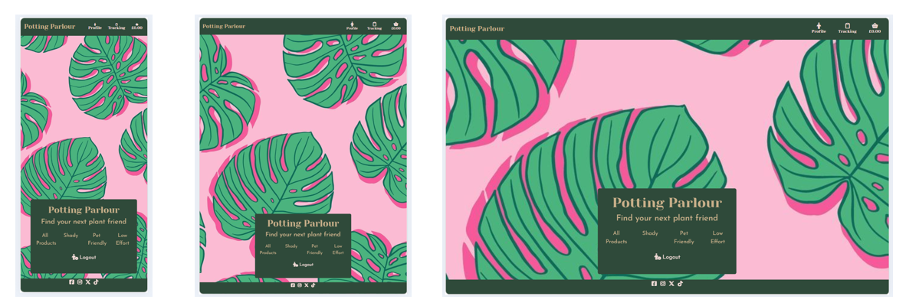

For the plants page:

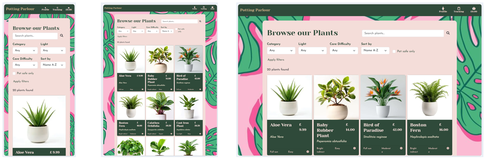

For the plant details page:

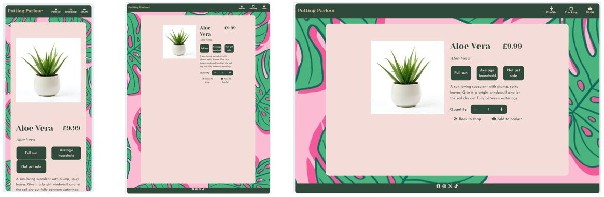

For the basket page:

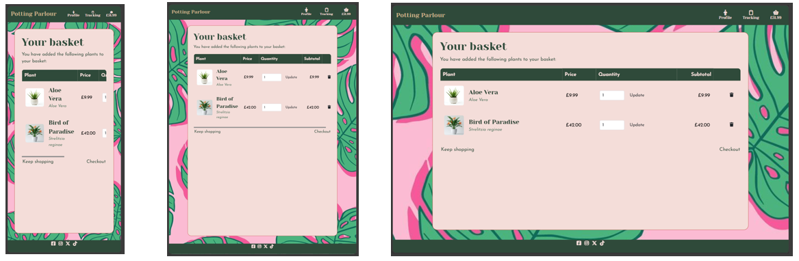

For the checkout page:

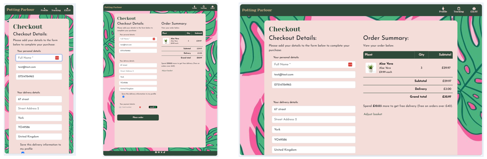

For the checkout success page:

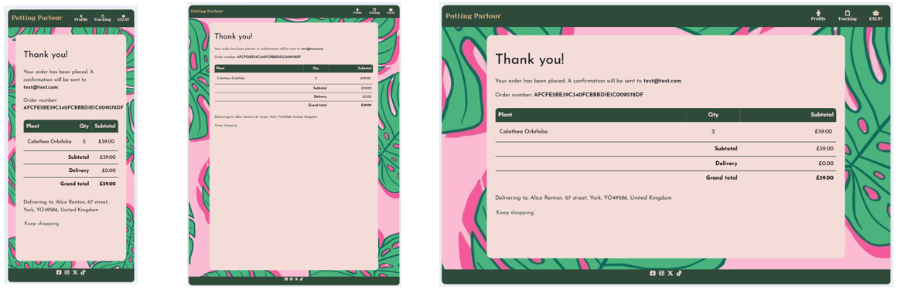

For the profile page:

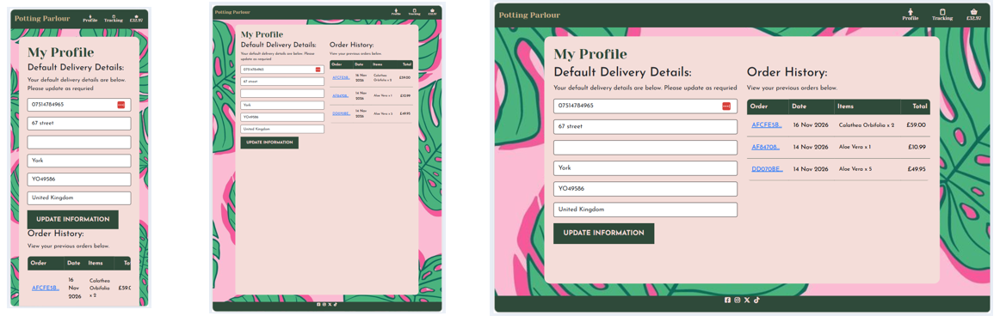

For the tracker page:

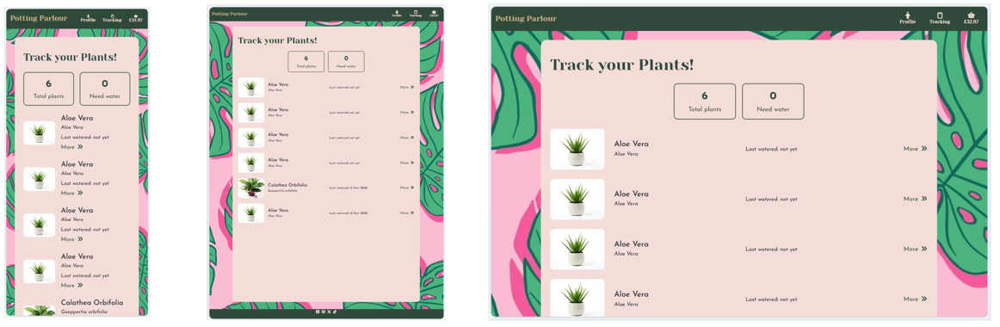

For the tracker details page:

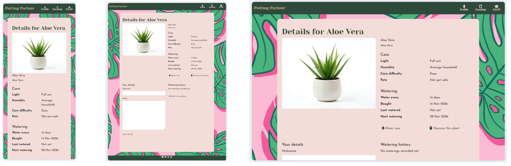

For the add/edit plant form:

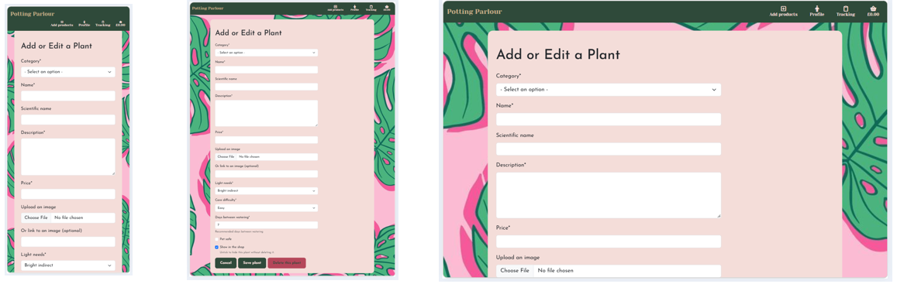

## Lighthouse Testing
I used the Lighthouse developer tool testing to ensure my website is loading efficiently, is accessible, follows best practice and is optimised for search engines. The outcomes are shown below.

For the home page:

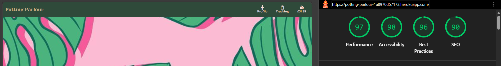

For the plants page:

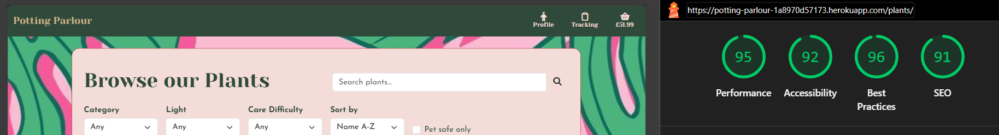

For the plant details page:

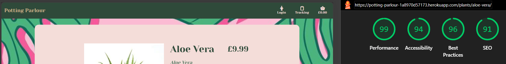

For the basket page:

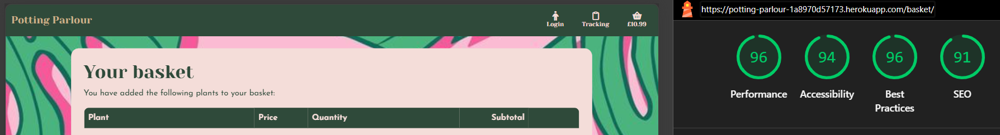

For the checkout page:

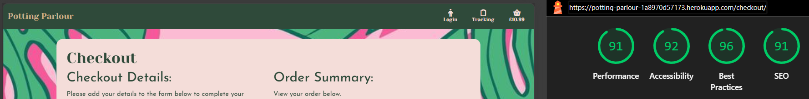

For the checkout success page:

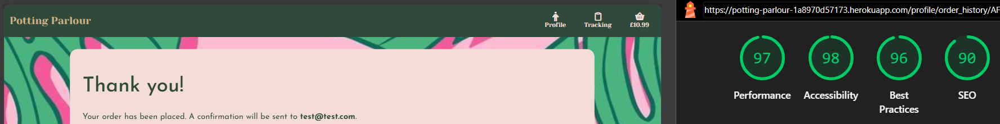

For the profile page:

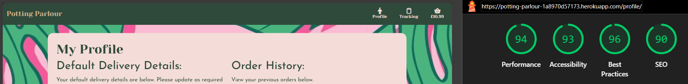

For the tracker page:

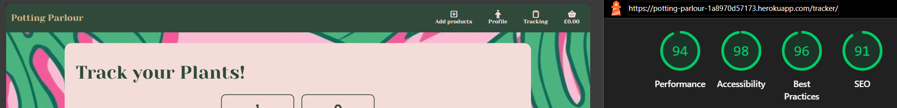

For the tracker details page:

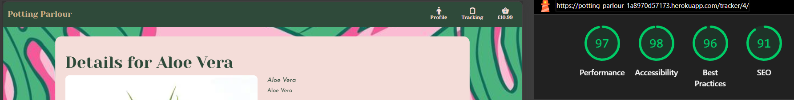

For the add/edit plant form:

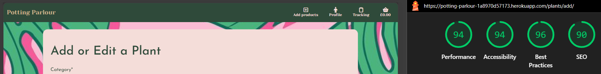

## HTML Testing
Using the [HTML Validator](https://validator.w3.org/), I tested each page by copying the page source into the validator and have received no errros

For the home page:

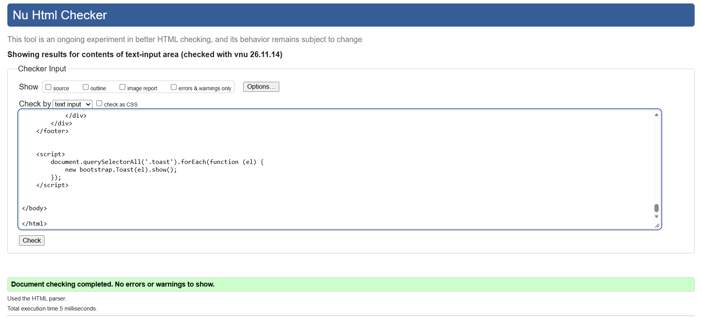

For the plants page:

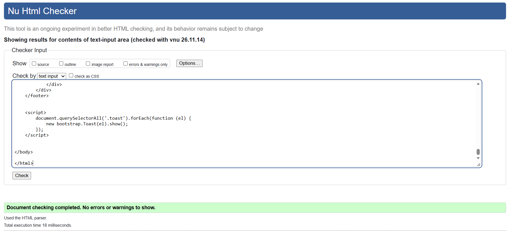

For the plant details page:

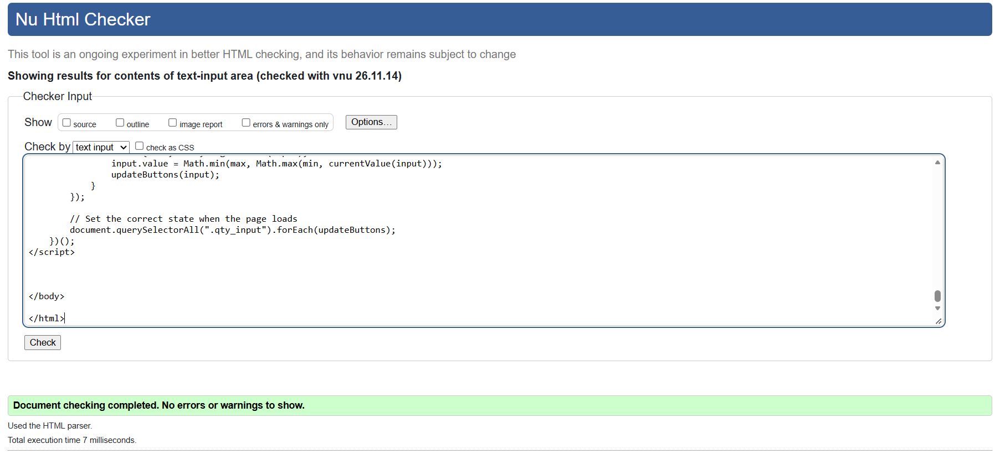

For the basket page:

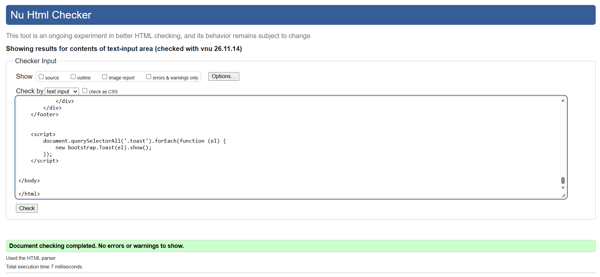

For the checkout page:

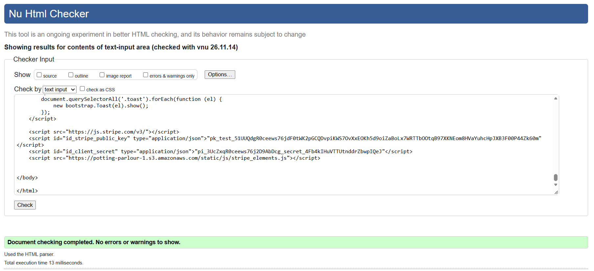

For the checkout success page:

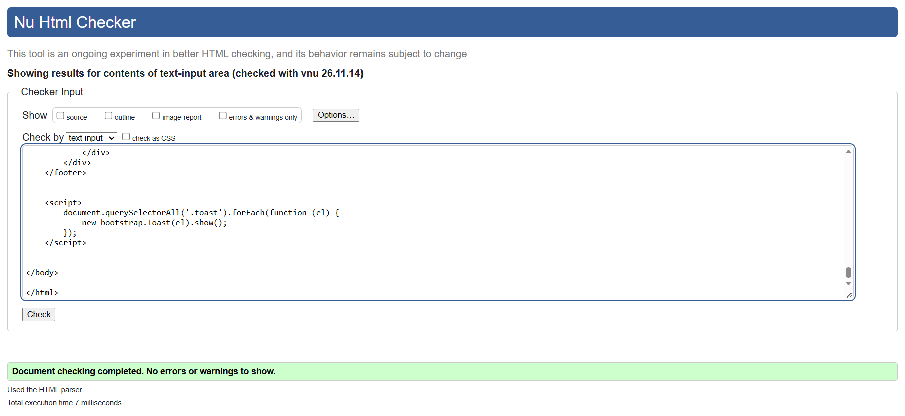

For the profile page:

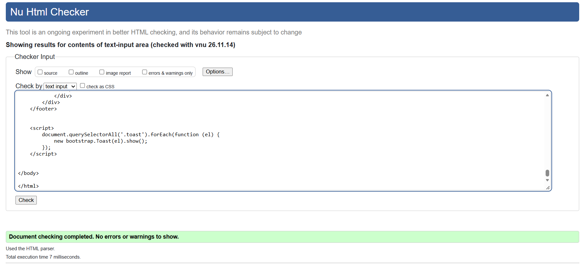

For the tracker page:

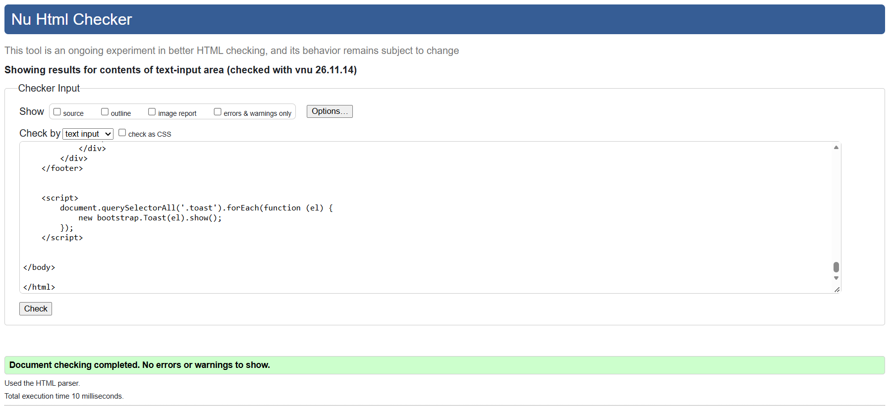

For the tracker details page:

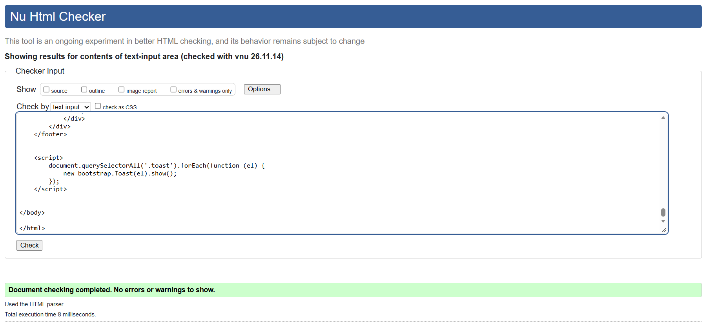

For the add/edit plant form:

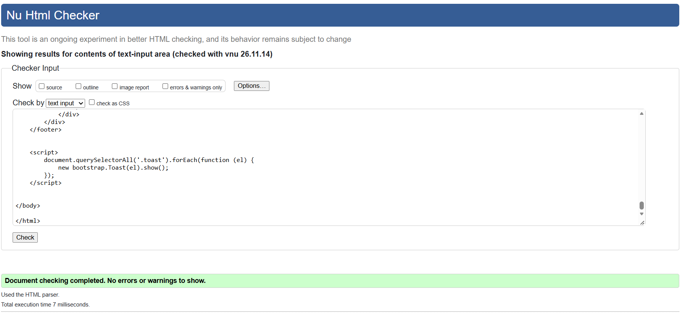

## CSS Testing
Using the [CSS Validator](https://jigsaw.w3.org/css-validator/), I have no recorded errors and no warnings.

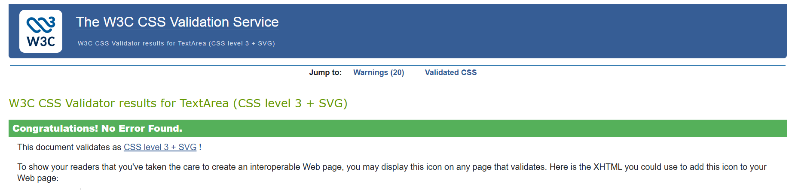

## JavaScript Testing
Using the [JavaScript Validator](https://jshint.com/), I have checked my stripe_elements.js file and the quantity_changes script.

For stripe_elements.js:

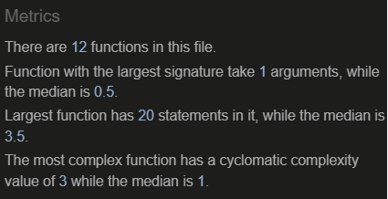

For quantity_changes.js:

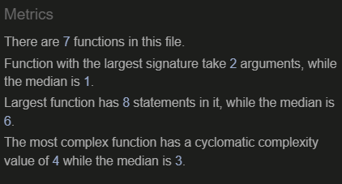

## Python Testing

## Django Testing
